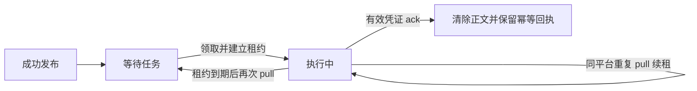

# 助理任务队列

为每个用户的 AI 个人助理提供独立优先级任务队列。当前已实现 Redis 发布、单任务租约领取、确认及只读状态查询；HTTP 字段和错误契约以[助理任务 API](../../api/assistant-task.md)为准。不增加 RabbitMQ 流。

## 设计原则

每个助理只维护任务队列，执行平台负责处理任务和交付结果，不单独建设助理结果队列。中间件负责可靠交付及完成确认，不执行助理业务，也不发送用户通知。

| 任务去向 | 平台完成的业务动作 | 确认时机 |
| --- | --- | --- |
| 给其他助理发消息 | 向目标用户助理的任务队列发布 assistant_message | 目标消息发布成功后确认原任务 |
| 给用户发消息 | 平台发送消息，或可靠写入本平台保证后续投递的发送存储 | 发送成功或可靠交接完成后确认原任务 |
| 提醒、心跳等任务 | 完成该任务约定的动作 | 动作完成后确认原任务 |

`ack` 表示调用平台声明本任务的业务处理已经完成。中间件只验证执行租约和交付凭证，不能独立核验外部消息是否送达。平台必须先完成业务动作或可靠交接，再确认任务；外部交付与 Redis 确认之间没有跨系统事务。

如果业务动作成功而 ack 丢失或租约过期，任务可能再次交付。给其他助理发消息时，使用原 task_id 派生稳定 request_id；同一任务产生多条消息时附加稳定的消息序号，调用方须保证重试进入同一幂等范围。给用户发送消息也应以任务和发送动作标识做幂等处理。发布去重有保留期，跨越保留期的重试需要平台自己的持久幂等记录。

---

## 职责与依赖

| 位置 | 职责 |
| --- | --- |
| `app/router/assistant.py` | 请求校验、平台认证依赖、HTTP 错误映射 |
| `app/service/assistant.py` | 四类任务优先级、幂等内容指纹、任务标识与响应装配 |
| `app/service/assistant_file.py` | 附件流式落盘、大小限制、内容 SHA-256 与幂等清理 |
| `app/infrastructure/redis_assistant.py` | Lua 原子状态转换、租约、恢复、容量和过期记录清理 |
| `app/config/assistant.py` | 读取本项目 .env 与进程环境，校验容量和时间配置 |
| `app/main.py` | 复用 Redis 连接池装配服务，并统一将存储异常转换为 503 |

沿用[Redis 部署](../infrastructure/redis.md)中的连接、认证和持久化；不为每个用户长期持有独立连接、消费者对象或后台任务。用户退出登录、平台失活、服务重启不会主动删除任务。

---

## Redis 数据结构

以用户 `10001` 为例，默认键前缀为 `middleware-service`：

| key 后缀 | Redis 类型 | 用途 |
| --- | --- | --- |
| `assistant:{10001}:tasks:ready` | Sorted Set | 等待任务，分数为优先级，成员为固定宽度入队序号及 task_id |
| `assistant:{10001}:tasks:payload` | Hash | task_id 到任务 JSON；包含等待及执行中的任务 |
| `assistant:{10001}:tasks:sequence` | String | INCR 递增序号，同级任务按序号排序 |
| `assistant:{10001}:tasks:processing` | Hash | 当前唯一执行任务的 ID、原排序成员、优先级、领取平台、交付凭证和租约截止时间 |
| `assistant:{10001}:tasks:requests` | Hash | 来源平台及 request_id 到内容指纹、原任务响应的幂等索引 |
| `assistant:{10001}:tasks:request-expiry` | Sorted Set | 已完成任务幂等索引的过期时间 |
| `assistant:{10001}:tasks:ack:<task_id>` | String，带 TTL | 已完成任务的领取平台和凭证，用于 ack 重试 |
| `assistant:{10001}:tasks:last-heartbeat` | String | 最近一次成功确认心跳任务的服务端 Unix 时间，保留微秒，不设置 TTL |
| `assistant:{10001}:tasks:pending-user-message` | String | 最近一条可继续追加用户消息的待领取任务 ID，领取时清除对应指针 |

完整 key 为 `<REDIS_KEY_PREFIX>:<表中后缀>`。原始 userid 使用 URL 百分号编码，避免冒号、大括号和百分号造成键空间歧义；普通数字 userid 保持原样。同一用户相关 key 使用相同 hash tag；当前应用和现有用户资料存储仍按单节点 Redis 部署，不声称已支持 Redis Cluster。

优先级映射为提醒 0、用户消息 1、其他助理消息 2、助理心跳 3。成员中的序号固定补齐到 20 位；原始序号以十进制字符串保存，避免时间戳碰撞、组合浮点分数和 Lua/客户端大整数精度问题。正文只按任务 ID 定位；发布幂等索引还会保留一份原任务响应，容量估算应计入这部分开销。

用户消息在 publish 阶段原子合并到同一 userid 最近的可追加任务，不移动其排序位置。原始片段保存在任务 JSON 的 user_messages 数组中，逐条记录消息 ID、原文、来源平台、请求标识和服务端接收时间；任务根部来源和请求标识沿用首条消息，created_at 更新为组内最晚消息的接收时间。不同平台的同用户消息也可合并，来源以各片段为准。

任务及各条原始消息另存 source_assistant_id，用于识别发送方助理，由生产平台通过 JSON 或 multipart 普通字段提供。新发布 assistant_message 必须填写非空白的 1～128 字符来源，不接受缺失或 null；其他类型可省略。路由模型与服务层共用来源校验，先校验再保存附件或写入 Redis；OpenAPI 的两种请求媒体类型均声明条件必填。认证来源平台仍由令牌确定，助理来源是生产者声明的业务元数据；目标 userid 不作为发送方推断依据。根部助理来源沿用首条，合并用户任务通过每个片段保留各自助理来源。assistant_message 始终独立入队，不能因相同或不同助理来源而合并。

助理来源参与内容指纹，保持原有 `(来源平台, userid, request_id)` 去重范围，同范围改变来源会冲突。其他类型未提供来源时不改变旧指纹。已存在的无来源消息仍可消费，读取时返回 null，无需清空或迁移；新发布或重试助理类型消息必须填写来源，不能补填来源覆盖旧幂等记录。

除条数和字节上限外，还校验新消息与候选任务最后一条原始消息的接收时间间隔。默认允许间隔不大于 30 秒，每次成功追加均刷新比较基准；这是相邻消息的滑动间隔，整组从首条到末条可以超过 30 秒。幂等重试直接返回原快照，不刷新时间或延长间隔。Lua 使用服务端整数微秒比较，恰好等于阈值允许追加，超出一微秒也另建任务；时钟回拨造成负间隔时另建任务。间隔校验只控制追加，不设置领取等待时间。

Redis 保存结构化原文片段，服务层按接收顺序以空行及 Markdown 分隔线（\n\n---\n\n）拼接正文，不添加消息编号、标题或时间。单条消息沿用原文；结构化字段保留 UTC 和微秒。发布幂等记录保存原始结构化快照，重试不会重复追加；展示文本统一使用当前拼接规则，最终消费内容以 pull 为准。

每个已领取任务持久标记为冻结，不论租约是否过期，其片段组成均不再变化。新消息进入下一条待领取任务；已有指针失效、合并时间间隔超限或任务达到合并上限时创建下一条任务。对升级前没有片段数据的待领取用户任务，可从原字段生成首条片段并继续按间隔规则判断；旧版执行中任务仍保持冻结。已合并的旧任务在响应时根据片段时间报告最晚 created_at，不要求清空数据。合并指针缺失时仅检查该优先级最后一个候选，不扫描全部任务。

确认合并任务时，一次清除整组正文及执行记录，并为所有原始 request_id 安排确认后去重保留期。无需为每个片段独立 ack；部分完成后不得确认整组。严格优先级保持不变，提醒优先于合并用户消息。

---

## 任务附件

publish 保留原有纯文本 JSON，同时支持 multipart 表单：files 重复上传文件，file_extensions 重复上传后缀，按两个列表的顺序对应。后缀仅允许 1～16 位英文字母或数字，转为小写；不根据文件名或 MIME 推断，也不验证内容实际格式。正文仍必须非空。详细字段和请求示例见[发布助理任务](../../api/assistant-task.md#发布助理任务)。

文件保存在 data/assistant-task/file/<file_id>.<file_extension>，使用服务端 UUID 独占创建，不采用客户端路径。在线程池中分块复制和计算 SHA-256，限制单文件大小，完成后 flush/fsync；Redis 中仅存文件引用，不存二进制。data/assistant-task/.gitkeep 保留目录结构，运行时文件不入 Git。Dockerfile 创建可由非 root 用户写入的附件目录；deploy 为该路径增加 assistant-files 命名卷，需与 Redis 一起备份。

每个任务根部 files 汇总全部引用；每条 user_messages[].files 只保存本条原始消息的附件，实现合并前后的明确对应关系。追加时同时检查整任务附件数，超限则另建任务。文件后缀及内容指纹参与发布幂等，忽略生成的文件 ID 和客户端名称；纯文本指纹保持旧版兼容。已获确认的重复发布或明确拒绝会删除本次新上传，保留原任务附件；Redis 结果不确定时保留文件，避免悬空引用。

文件通过[助理附件资源接口](../../api/resource.md#读取助理任务附件)下载，所有有效登录平台可读，与队列访问范围一致，不改变审核附件的 registry 限制。resource 只读取普通文件、拒绝符号链接，并分块输出，查询和下载不续租。

ack 先确认 Redis 状态，再删除整个任务的附件。确认回执保留附件清单，磁盘清理失败时可在回执保留期内重试相同 ack；缺失文件视为已清理。清理失败会明确返回 503，不能将其误认为 Redis 未确认。任务未确认时文件持续保留，超时重领继续使用原引用；结果不确定或异常中断可能产生未引用文件，当前不做后台全目录回收。调用方必须在 ack 前完成下载、业务使用或可靠转存。

---

助理心跳由生产端定期发布，助理消费后自行执行空闲保活行为，再确认完成；中间件不运行周期心跳生成器，不以心跳消息替代平台登录续期、用户登录续期或任务执行租约。心跳沿用普通任务容量和重试规则，等待心跳不会抢占任何更高优先级任务；已经领取的心跳也不会被后来任务中断。

状态查询通过一次只读 Lua 脚本取得 Redis 当前时间、执行记录和历史心跳，形成一致快照，不扫描用户或队列。只有租约仍有效时返回执行中任务信息；过期记录保留原状，等待下一次 pull 恢复，不因查询自动续租或重排。查询不返回任务正文、交付凭证或平台令牌。

`last_heartbeat_at` 只在首次成功 ack `heartbeat` 时与任务确认一并更新；发布、领取、普通任务完成、重复 ack 和失败 ack 均不刷新。历史时间不随任务正文清理或服务重启丢失，也不会因查询而创建记录。未确认过心跳、升级前缺少记录的用户返回 null，不从旧任务时间推断历史。该时间用于观察，不直接推导助理在线状态；没有执行中任务可能表示空闲，有有效租约也不能证明执行进程健康。

---

## 状态转换

等待任务按优先级及同级序号排序。有效执行租约不被新任务抢占，同平台重复领取只返回当前任务。超时后的下一次拉取恢复旧任务，再统一排序，因此新的高优先级任务可能先于刚恢复的低优先级任务交付；旧任务不会丢失原序号。

Lua 脚本串行完成领取与状态迁移，防止多个调用取走同一用户的不同任务。确认同时核对用户、任务、平台、交付凭证和服务端租约；过期或旧凭证返回冲突。已确认任务的回执允许相同确认请求在保留期内重试，不修改后续任务。

租约到期代表允许重领，不保证旧执行者已经停止；同平台重复 pull 也可能被多个调用者接收。因此任务执行仍须幂等，不能承诺端到端恰好一次。当前没有失败次数上限、死信队列或主动后台回收；任务超时由下一次该用户的 pull 触发恢复。严格优先级下低优先级可能长期等待，暂不实现优先级老化。

---

## 配置与容量

| 环境变量 | 默认值 | 说明 |
| --- | --- | --- |
| `ASSISTANT_TASK_MAX_PER_USER` | `1000` | 每个用户等待与执行中任务的总数上限 |
| `ASSISTANT_TASK_LEASE_SECONDS` | `300` | 领取和同平台重复 pull 续租的有效秒数 |
| `ASSISTANT_TASK_RECEIPT_TTL_SECONDS` | `86400` | 确认回执及已完成任务发布去重索引的保留秒数 |
| `ASSISTANT_USER_MESSAGE_MERGE_MAX_MESSAGES` | `20` | 每条用户任务可合并的原始消息条数 |
| `ASSISTANT_USER_MESSAGE_MERGE_MAX_BYTES` | `65536` | 允许合并的原文 UTF-8 字节总数，不包含标题及元数据 |
| `ASSISTANT_USER_MESSAGE_MERGE_INTERVAL_SECONDS` | `30` | 相邻用户消息允许合并的最大间隔秒数，等于阈值允许合并 |
| `ASSISTANT_TASK_MAX_FILES` | `10` | 单次上传及合并后单任务的附件数量上限 |
| `ASSISTANT_TASK_MAX_FILE_BYTES` | `20971520` | 单个附件最大字节数，默认 20 MiB |

全部必须为正整数；进程环境覆盖项目根目录 `.env`，修改后重启生效。`.env.example` 提供模板。不增加第三方依赖，也不要求变更 RabbitMQ 容器初始化。

发布时限制单条原始消息为 10000 字符；合并达到条数或原文总字节阈值后另建任务，单条超出合并字节阈值的合法消息独立保存。单用户容量按任务数计算，包含等待和执行中任务；已满时符合条件的用户消息仍可追加，需要新任务时返回 429，不裁剪未完成任务。

常规入队、领取的排序操作为 O(log n)，按任务 ID 取正文为平均 O(1)；合并与响应格式化另外需要 O(m + b)，m 为原始片段数、b 为文本字节数，受合并阈值约束。每条原始发布的幂等快照可能包含截至当时的累计片段，内存估算须计入这些快照，不能只按待领取任务数估算。每次操作额外最多回收 100 条已过期的去重索引，以限制单次清理开销。幂等索引过期判断使用 Redis 时间，不依赖后端本机时钟。

没有待处理任务时，幂等索引整键设置 TTL；新任务入队时取消整键 TTL，避免误删仍在等待任务的去重记录。确认回执独立过期；用户序号键保留以维持递增。任务没有自动过期时间，离线助理的积压会持续占用容量；这里的条数上限不是 Redis 全局字节上限，实际内存随活跃用户、消息字节数及确认保留期内的吞吐增长。

Redis 继续采用现有单节点、AOF 每秒同步配置，异常断电可能丢失最近尚未刷盘的修改。Redis 故障返回 503，不回退进程内缓存；请求超时可能已生效，应使用发布 request_id、重复 pull 或相同 ack 凭证核对结果。

---

## 验证

使用本机真实 Redis 与随机测试键前缀验证四类优先级及同级顺序、心跳发布与确认、并发发布幂等、大整数序号、按用户隔离、单任务执行、不抢占、续租、超时恢复、旧凭证拒绝、重复确认、容量释放及 HTTP 认证与错误映射。另验证助理 A 向 B 发布消息后确认原任务的完整链路，以及发布和确认重试不会重复生成 B 的任务。状态查询覆盖未知用户、等待/执行/过期任务、只读性、心跳确认时间及重试不刷新、跨用户隔离、服务重建和认证失败。测试只清理自身命名空间，不修改现有业务队列。

用户合并覆盖发布阶段多条入一个任务、仅分隔线排版、原始来源及标识保留、并发追加、提醒优先、领取后冻结、整组超时恢复、全部片段去重保留、条数及 UTF-8 字节阈值拆分、任务容量已满时追加和旧任务兼容。额外验证最晚消息时间、滑动间隔、恰好达到与超出一微秒的边界、重试不延长间隔、自定义间隔及服务端时钟回拨。

多附件使用临时目录及真实 Redis 验证类型和文件的顺序对应、原始消息归属、合并附件上限、下载权限、确认后清理、重复发布内容指纹、异常上传回滚、未知发布结果保留及清理失败的回执重试。

助理来源覆盖 JSON/multipart 发布与 pull 返回、合并用户任务逐条保留、无来源历史数据、来源字段校验及来源变化的幂等冲突；另验证同来源和不同来源的 assistant_message 都保持独立任务。条件必填验证缺失/null/空白来源拒绝、其他类型可省略、服务层直调不能绕过、失败时不落盘及 OpenAPI 条件声明。
